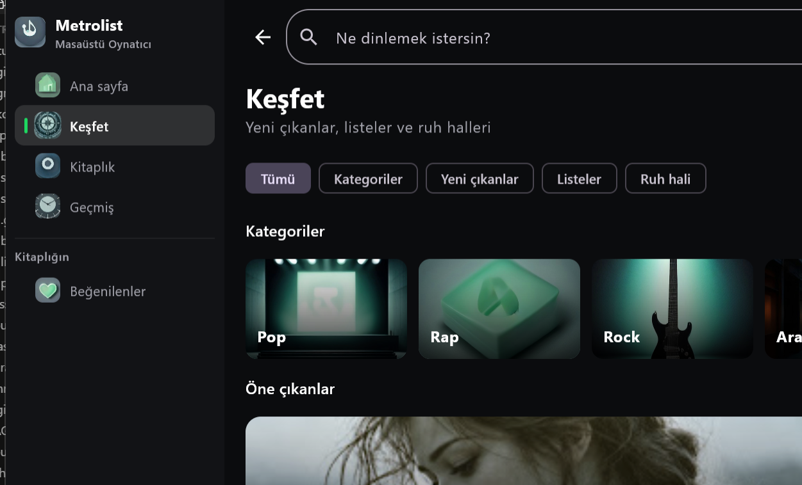

# Metrolist Windows

Masaüstü için YouTube Music istemcisi. Telefon uygulamasının yerine geçmez; Windows’ta arama, ana sayfa, keşfet, kitaplık ve çalmayı tek pencerede toplar.

İngilizce özet: a third-party YouTube Music client for Windows. It is not affiliated with YouTube, Google, or Spotify.



## Ne yapar

- Oturum açmadan şarkı çalar. Akış, herkese açık Invidious ve Piped uçlarından gelir; onlar yetmezse Innertube yedeği denenir.
- Ana sayfa, arama, albüm, sanatçı ve çalma listesi.
- Keşfet: Pop, Rap, Rock, Arabesk, Halk, Caz, Elektronik ve Akustik rafları, yeni çıkanlar ve ruh halleri.
- Bu bilgisayarda beğenilenler ve yerel çalma listeleri. Çerez olmadan da durur.
- Çaldığın şarkı bitince benzerleri sıraya eklenir, çalma devam eder.
- Kitaplık (beğenilenler, listeler, albümler, sanatçılar) için music.youtube.com çerezi. Çerez olmadan çalma açıktır.
- Bu bilgisayardaki dinleme geçmişi.
- Vurgu rengi, panel, köşe ve kart boyutu. Seçim `%LOCALAPPDATA%\Metrolist` altında durur.
- Sözler, sıra, karıştır, tekrar, ses.

Android Auto, Cast ve Listen Together bu masaüstü sürümünde yok. Masaüstü widget’ı, görev çubuğu kontrolleri ve medya tuşları desteklenir.

## Arayüz

Koyu bir kabuk: solda gezinme, ortada içerik, altta oynatıcı. Oynatıcıda kapak ve ad solda, taşıma ve ince ilerleme çubuğu ortada, ses ve sıra sağda. Süre bilinmiyorsa çubuk sona yapışmaz; süre `—:—` görünür ve akıştan okununca dolar.

## Uygulama içinden otomatik güncelleme

Ayarlar → Sistem → Güncelleme bölümünde **Yeni sürümleri otomatik kontrol et** ve **Güncellemeleri arka planda indir** seçenekleri bulunur. Varsayılan olarak açıktır. Uygulama açılıştan kısa süre sonra ve yaklaşık üç saatte bir bu deponun [GitHub Releases](https://github.com/sylorx/Metrolist-Windows/releases) sayfasındaki son kararlı sürümü kontrol eder. Elle kontrol, indirme iptali ve hata sonrası yeniden deneme de desteklenir.

Yeni sürüm indirilip doğrulandığında **Yeniden başlat ve güncelle** görünür. Seçildiğinde çalma sırası/konumu kaydedilir; ayrı yardımcı süreç uygulamanın kapanmasını bekler, Windows kurucusunu sessiz modda çalıştırır ve uygulamayı yeniden açar. Windows kurulum için yönetici izni isteyebilir. Kullanıcı bu izni reddederse veya kurulum başarısız olursa sonuç sonraki açılışta Ayarlar’da gösterilir. Kurulum yardımcısı başlamazsa uygulama açık kalır. Uygulama kullanıcı tıklamadan kapanmaz.

Paketin GitHub tarafından bildirilen boyutu, SHA-256 özeti ve Windows EXE başlığı doğrulanır. Eksik/bozuk indirme çalıştırılmaz; `.part` dosyası temizlenir. Yalnızca bu deponun sürüm indirme adresindeki `Metrolist-<sürüm>.exe` kabul edilir. Taslak ve ön sürümler kurulmaz. Yeni sürümde uygun dosya veya GitHub `digest` bilgisi yoksa uygulama bunu açıkça gösterir. [GitHub varlık API’si](https://docs.github.com/en/rest/releases/assets) SHA-256 bilgisini `digest` alanında sağlar. Kurucu argümanları [OpenJDK 21 jpackage EXE sarmalayıcısı](https://github.com/openjdk/jdk21u/blob/master/src/jdk.jpackage/windows/native/msiwrapper/MsiWrapper.cpp) üzerinden Windows Installer’a iletilir.

Güncelleme günlükleri `%LOCALAPPDATA%\Metrolist\updates` içindeki `helper.log`, `installation.log` ve `update-result.json` dosyalarındadır. Kurulum başarısızlığında mevcut uygulama dosyası hâlâ varsa yeniden açılır; kullanıcı kitaplığı uygulamanın kurulum klasörünün dışında tutulur. İçeriden kurulum paketlenmiş `Metrolist.exe` sürümünde kullanılabilir; Gradle/Java ile geliştirme çalıştırmasında kurulum başlatılmaz.

Yeni sürüm yayımlamak için:

1. `desktop/build.gradle.kts` içindeki `packageVersion` ve `AppVersion.NAME` değerlerini aynı, daha büyük sürüme yükselt.
2. `powershell -File scripts/Build-Release.ps1` ile testleri çalıştır ve kurucuyu üret. Betik sürüm tutarlılığını kontrol eder; EXE yanında SHA-256 dosyası da oluşturur.
3. GitHub’da `v1.2.0` gibi bir kararlı Release aç ve üretilen `Metrolist-1.2.0.exe` dosyasını ekle. GitHub dosyanın `digest` alanını hazırladıktan sonra istemciler güncellemeyi indirebilir. Betik kendi başına yayın yapmaz.

Bu özellik için hesap çerezi veya GitHub erişim anahtarı gerekmez; sürümler ve varlıklar herkese açık olmalıdır.

## Derlemek

Yan yana iki klasör gerekir. Innertube kaynakları Android ağacından okunur, kopyalanmaz.

```
Metrolists-main/        https://github.com/MetrolistGroup/Metrolist
Metrolist-windows/      bu depo
```

JDK 21 ve `jpackage` içeren bir JDK (Android OpenJDK 21 uygundur).

```bat
set JAVA_HOME=C:\Program Files\Android\openjdk\jdk-21.0.8
gradlew.bat :desktop:createDistributable
```

Çalışan program: `desktop\build\compose\binaries\main\app\Metrolist\Metrolist.exe`

Kurucu: `desktop\build\compose\binaries\main\exe\Metrolist-1.1.0.exe`

## Veriler

Ayar, geçmiş ve kapak önbelleği `%LOCALAPPDATA%\Metrolist` içindedir. Oturum çerezi Windows DPAPI ile mevcut Windows kullanıcısına bağlı `account.dpapi` dosyasında korunur. Eski düz metin ayar ve ayar yedeği ilk başarılı geçişte temizlenir. JSON yedekleri hesap çerezini içermez.

## Gelişmiş özellikler

- **Sıra:** şarkıdaki `•••` menüsünden sonraki çal/sona ekle; sıra panelindeki `≡` tutamacından sürükleyerek sırala, `×` ile çıkar veya sırayı bir listeye kaydet. Karıştırma bir turda aynı parçayı tekrar seçmez. Açılışta sıra ve konum korunur.
- **Listeler:** ad değiştir, sil, M3U8 olarak dışa aktar; kutucuklarla çoklu seçim yaparak sıraya veya başka listeye ekle ve listeden çıkar. Liste düzeni sürükleme ya da ok düğmeleriyle değişir.
- **Akıllı listeler:** son 30 günün beğenileri, uzun zamandır dinlenmeyenler ve en çok dinlenenler. Eski kayıtlarda beğenme tarihi bilinmiyorsa yeni beğeni gibi gösterilmez.
- **Ses:** Ayarlar → Ses altında 10 bant ekolayzır, hazır profiller, ses seviyesi dengeleme, çıkış cihazı, sonraki parçayı hazırlama ve 0–12 saniye crossfade. Yerel dosyalarda da çalışır. Sonraki kaynak zamanında hazırlanamadığında normal geçiş kullanılır. Ses aygıtının birden fazla çıkış akışını desteklemesi gerekir.
- **Bağlantı kurtarma:** parça ortasında hata oluşursa aynı konumdan en fazla iki kez kaynak yenilenir; kaynak alternatifleri de denenir. Hata çözülemezse **Yeniden dene** görünür. FFmpeg bağlantıları süre sınırı kullanır.
- **Sözler:** yerel dosyanın yanındaki aynı adlı `.lrc` dosyası önceliklidir. Çevrimiçi eşleşme için [LRCLIB API](https://lrclib.net/docs) kullanılır; zamanlı söz bulunmazsa YouTube Music düz sözleri denenir. Zamanlı satıra tıklayarak o ana git; otomatik takibi aç/kapat. Başarılı sonuçlar 7 gün önbelleklenir. LRCLIB hız sınırına uyulur. Her parçanın zamanlı söz kaydı olmayabilir.
- **Yerel müzik:** klasör ekle/tara/iptal et/kaldır. MP3, FLAC, WAV, OGG, OPUS, M4A, AAC, WMA ve AIFF; dosya etiketleri, gömülü kapak ve `cover.jpg`/`folder.jpg` desteği. Dosyalar kopyalanmaz veya YouTube’a yüklenmez. Bağlı olmayan diskin indeksi korunur.
- **İstatistikler:** hafta, 30 gün ve yıl görünümü; gerçek dinleme süresi, farklı parça sayısı, günlük grafik ve sanatçı sıralaması. Duraklatılan ve ileri sarılan süreler sayılmaz. Eski geçmişten süre tahmini yapılmaz. Kayıtlar gün ve parça bazında birleştirilir; son 400 günlük süre verisi korunur.
- **Uyku:** Ayarlar → Uyku altında hazır/özel süre veya parça sonunda durdurma. Süreli zamanlayıcı son 10 saniyede sesi azaltır; kullanıcının ses ayarı değişmez. Zamanlayıcı uygulama yeniden başlatılınca devam etmez.
- **Yedekleme:** Ayarlar → Veriler’den JSON dışa aktar/birleştir. Beğeniler, listeler, geçmiş, dinleme süreleri ve ayarlar taşınır; müzik dosyaları, hesap çerezi, bu bilgisayarın klasör ve ses aygıtı seçimi taşınmaz. Mevcut aynı kimlikteki listeler korunur. İçe aktarımdan önce `before-import.json` kurtarma kopyası oluşur.
- **Eşitleme:** hesap açıkken yapılan beğenme/beğeniyi kaldırma, liste oluşturma, ekleme/çıkarma, ad ve sıra değişiklikleri kalıcı bir işlem kuyruğuyla YouTube Music’e gönderilir. Hata halinde kuyruk korunur ve yeniden denenir. Ayarlar → Veriler bekleyen işlem ve hatayı gösterir. Uzak liste kimliği yerelde saklanır. Başka oturuma ait bekleyen işlemler gönderilmez. YouTube uçlarının davranışı ve hesap yetkileri bağlantının başarısını etkileyebilir.

Ayarlar, kitaplık, geçmiş, sıra ve dinleme süreleri önce geçici dosyaya yazılıp atomik değiştirilir; önceki belge `.bak` olarak saklanır. Ana belge bozuksa yedek denenir. İki kopya da bozuksa bozuk belge kurtarma için ayrıca saklanır ve kullanıcıya bildirilir.

## Kontroller

```powershell
$env:JAVA_HOME = 'C:\Program Files\Android\openjdk\jdk-21.0.8'
.\gradlew.bat :desktop:test :desktop:createDistributable
```

Testler kitaplık ve yedekten kurtarma, çerezin DPAPI’ye taşınması, LRC ayrıştırma, gerçek FFmpeg dosya taraması, ekolayzır, sıra düzenleme, tekrar, duraklatılmış arama, bağlantı kurtarma, crossfade ve uyku zamanlayıcısını kapsar. Oynatma politikası `PlaybackEngine` ve `PlaybackStreams` arayüzleriyle ses aygıtı ve ağdan bağımsız test edilir.

İzole bir veri klasörüyle arayüz denemesi için JVM’ye `-Dmetrolist.dataDir=C:\test\Metrolist` verilebilir. Normal açılışta `%LOCALAPPDATA%\Metrolist` kullanılır.
